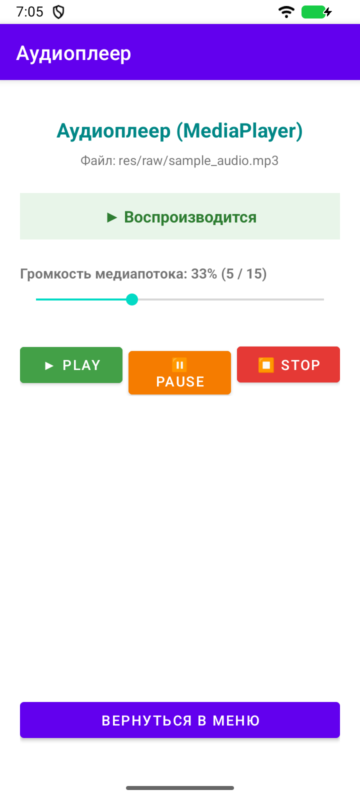
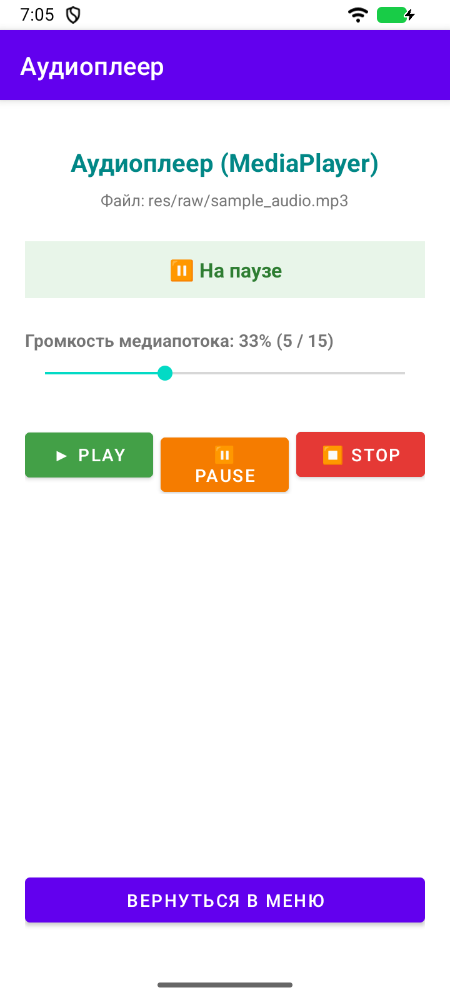
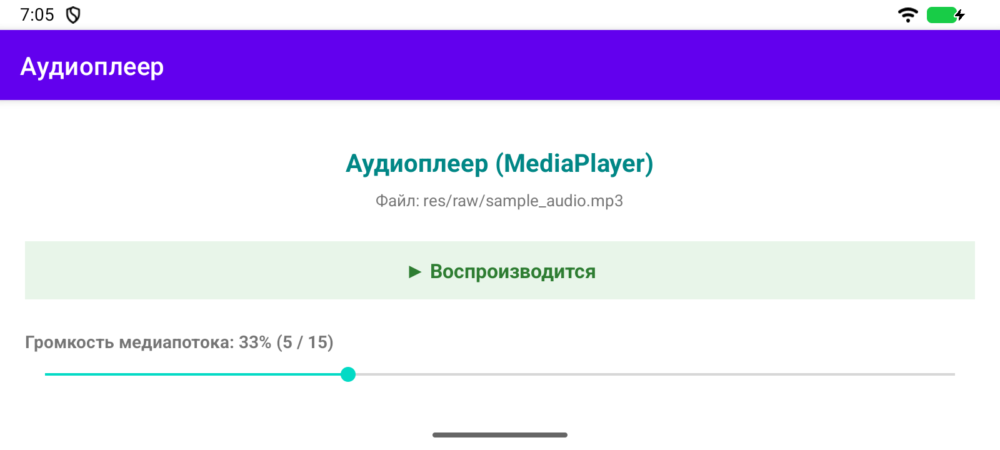
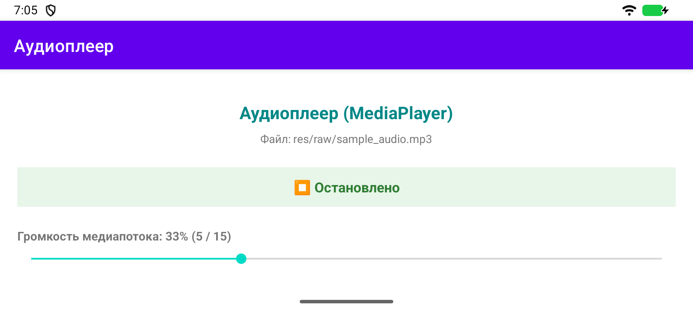
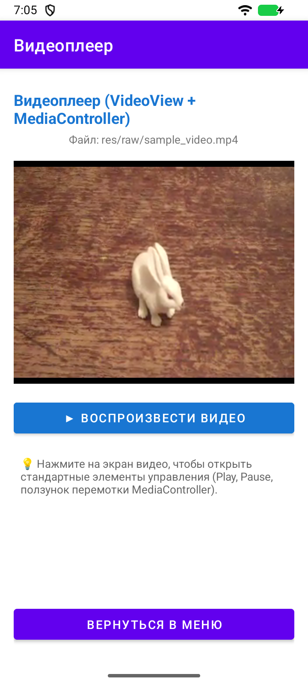
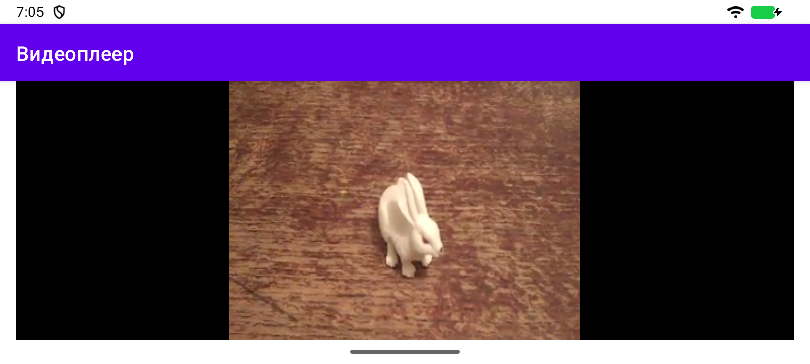
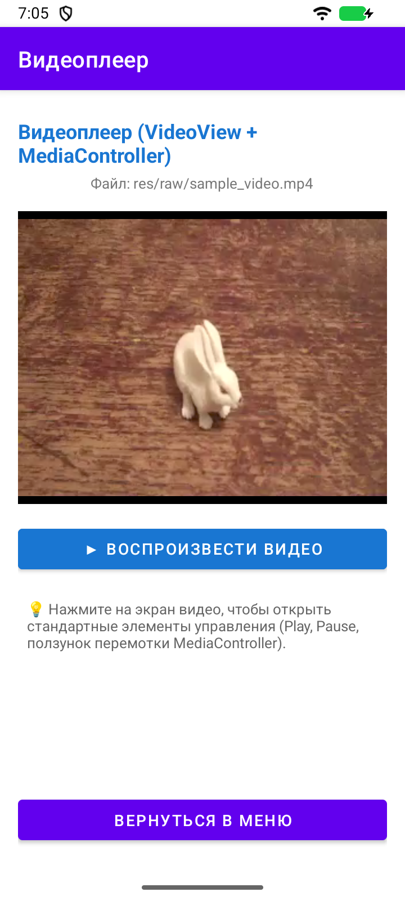

# Лабораторная работа 6

## Локальное аудио и видео

Студент: Ретунский Савелий. Проверка: 10 ноября 2026 года.

## Цель

Воспроизводить ресурсы res/raw, регулировать STREAM_MUSIC и корректно восстанавливать состояние плееров.

## Структура

MainActivity → AudioActivity / VideoActivity. Аудио: MediaPlayer + AudioManager. Видео: VideoView + MediaController, URI android.resource://package/R.raw.sample_video.

## Реализация и исправления

1. В res/raw находятся sample_audio.mp3 и sample_video.mp4. Аудио загружается через MediaPlayer.create, видео — через URI android.resource://.

2. Аудио имеет Play/Pause/Stop и статус. Pause сохраняет позицию, Stop освобождает плеер и сбрасывает позицию в 0. Ползунок и аппаратные кнопки громкости управляют STREAM_MUSIC.

3. Позиция, состояние и намерение продолжить воспроизведение сохраняются в Bundle. При уходе с экрана аудио приостанавливается; в onStop/onDestroy ресурсы освобождаются. Возврат и пересоздание создают новый плеер с сохранённой позицией.

4. VideoView оснащён MediaController. После подготовки восстанавливаются позиция и режим Play/Pause. Видео не запускается автоматически, если до поворота стояло на паузе. stopPlayback вызывается при остановке/уничтожении Activity.

5. Удалён configChanges, который обходил пересоздание VideoActivity. Ошибки создания/воспроизведения обрабатываются с Snackbar, ошибочный MediaPlayer освобождается.

## Проверка

Сборка `assembleDebug assembleDebugAndroidTest lintDebug`: успешно. Android Lint: 0 ошибок, 44 предупреждений. Предупреждения включают строки в XML вместо ресурсов, локализацию и рекомендации по зависимостям; они не скрыты baseline-файлом.

Эмулятор: Medium Phone, Android 16 API 36.1, x86_64. Тест `LabRegressionTest`: пройден. Исходник теста: [LabRegressionTest.kt](../app/src/androidTest/java/com/example/lab6_media/LabRegressionTest.kt).

`connectedDebugAndroidTest` в этой Windows-среде не запустил Gradle Worker (`GradleWorkerMain` не найден). Те же собранные тестовые APK запускались через `adb shell am instrument -w …/androidx.test.runner.AndroidJUnitRunner`. Для повторения: `./verify.ps1 -DeviceTests` на отдельном эмуляторе. Скрипт очищает учебные данные приложения на эмуляторе.

Лог запуска:

```text
com.example.lab6_media.LabRegressionTest:.

Time: 44.343

OK (1 test)
```

## Скриншоты сценариев

### 01-audio-play



### 02-audio-pause



### 03-audio-rotated



### 04-audio-stop



### 05-video-play



### 06-video-rotated



### 07-video-paused-restored



## Фрагменты кода

### AudioActivity.kt

[Полный исходник](../app/src/main/java/com/example/lab6_media/AudioActivity.kt)

```kotlin
private fun preparePlayer(): MediaPlayer? {
        mediaPlayer?.let { return it }
        return try {
            val player = MediaPlayer.create(this, R.raw.sample_audio)
                ?: throw IllegalStateException("Не удалось открыть аудиофайл")
            mediaPlayer = player
            player.setOnErrorListener { _, _, _ ->
                showError()
                true
            }
            player.setOnCompletionListener {
                position = 0
                state = "completed"
                renderState()
            }
            player.seekTo(position)
            player
        } catch (error: Exception) {
            showError()
            null
        }
    }
```

### AudioActivity.kt

[Полный исходник](../app/src/main/java/com/example/lab6_media/AudioActivity.kt)

```kotlin
override fun onSaveInstanceState(outState: Bundle) {
        outState.putInt("position", mediaPlayer?.currentPosition ?: position)
        outState.putString("state", state)
        outState.putBoolean("playing", mediaPlayer?.isPlaying == true || resumePlayback)
        super.onSaveInstanceState(outState)
    }
```

### AudioActivity.kt

[Полный исходник](../app/src/main/java/com/example/lab6_media/AudioActivity.kt)

```kotlin
override fun onStopTrackingTouch(bar: SeekBar?) {}
```

### VideoActivity.kt

[Полный исходник](../app/src/main/java/com/example/lab6_media/VideoActivity.kt)

```kotlin
class VideoActivity : BaseActivity() {
    private lateinit var videoView: VideoView
    private lateinit var progressBar: ProgressBar
    private var prepared = false
    private var position = 0
    private var resumePlayback = false

    override fun onCreate(savedInstanceState: Bundle?) {
        super.onCreate(savedInstanceState)
        setContentView(R.layout.activity_video)
        videoView = findViewById(R.id.videoPlayer)
        progressBar = findViewById(R.id.progressBar)
        position = savedInstanceState?.getInt("position") ?: 0
        resumePlayback = savedInstanceState?.getBoolean("playing") ?: false
        val controller = MediaController(this)
        controller.setAnchorView(videoView)
        videoView.setMediaController(controller)
        videoView.setOnPreparedListener { player ->
            prepared = true
            progressBar.visibility = View.GONE
            if (position > 0) {
                player.setOnSeekCompleteListener {
                    player.setOnSeekCompleteListener(null)
                    if (resumePlayback) videoView.start()
                }
                videoView.seekTo(position)
            } else if (resumePlayback) videoView.start()
        }
        videoView.setOnCompletionListener {
            position = 0
            resumePlayback = false
        }
        videoView.setOnErrorListener { _, _, _ ->
            prepared = false
            resumePlayback = false
            progressBar.visibility = View.GONE
            Snackbar.make(videoView, "Не удалось открыть видеофайл. Нажмите Play для повтора.", Snackbar.LENGTH_LONG).show()
            true
        }
        findViewById<Button>(R.id.btnPlayVideo).setOnClickListener {
            resumePlayback = true
            if (prepared) videoView.start() else openVideo()
        }
        findViewById<Button>(R.id.btnBack).setOnClickListener { finish() }
    }

    private fun openVideo() {
        prepared = false
        progressBar.visibility = View.VISIBLE
        try {
            videoView.setVideoURI(Uri.parse("android.resource://$packageName/${R.raw.sample_video}"))
        } catch (error: Exception) {
            resumePlayback = false
            progressBar.visibility = View.GONE
            Snackbar.make(videoView, "Не удалось открыть видеофайл", Snackbar.LENGTH_LONG).show()
        }
    }

    override fun onStart() {
        super.onStart()
        openVideo()
    }

    override fun onResume() {
        super.onResume()
        if (prepared && resumePlayback) videoView.start()
    }

    override fun onPause() {
        if (prepared) {
            position = videoView.currentPosition
            resumePlayback = videoView.isPlaying
            videoView.pause()
        }
        super.onPause()
    }

    override fun onSaveInstanceState(outState: Bundle) {
        outState.putInt("position", if (prepared) videoView.currentPosition else position)
        outState.putBoolean("playing", videoView.isPlaying || resumePlayback)
        super.onSaveInstanceState(outState)
    }

    override fun onStop() {
        videoView.stopPlayback()
        prepared = false
        super.onStop()
    }

    override fun onDestroy() {
        videoView.stopPlayback()
        super.onDestroy()
    }
}
```

## Вывод

MediaPlayer требует явного управления состояниями и release(). VideoView упрощает подготовку видео и работу стандартных контролов. Состояние пользователя сохраняется отдельно от ресурсов: при пересоздании Activity старый плеер освобождается, а новый восстанавливает позицию и режим. Проверены состояния плеера на эмуляторе; субъективная оценка звука и физическая Bluetooth-гарнитура не входили в автоматический тест.
